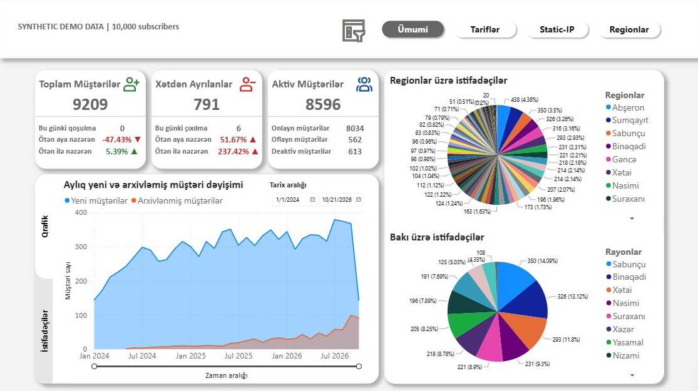
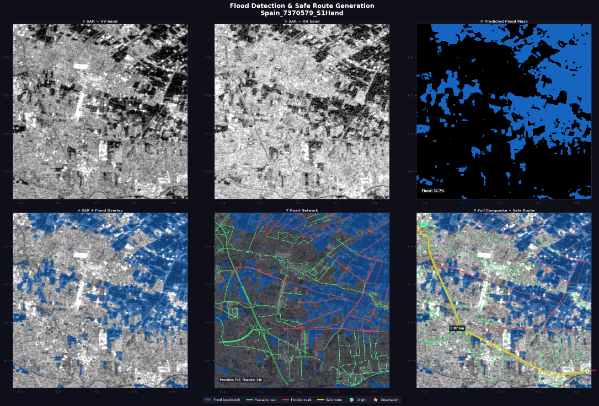

# Tariyel Badalzade

**Data Analyst | SQL · PostgreSQL · Power BI · DAX · Python**

I build data-driven solutions that turn operational and customer data into useful insights. My work spans **business intelligence, KPI reporting, dashboard development, Python data processing, and machine learning**.

Based in Baku, Azerbaijan · [LinkedIn](https://www.linkedin.com/in/tariyelbadalzade/) · [Portfolio guide](START-HERE.md)

---

## Analytics portfolio

### 📊 [Azerbaijan ISP Analytics Dashboard](projects/azerbaijan-isp-analytics/)

**Power BI · DAX · Power Query · Data modeling · Customer analytics**

A four-page, interactive BI report exploring customer status, subscription trends, tariff adoption, billing, and regional performance for a fictional ISP.

- **Customer and business KPIs:** 10,000 synthetic subscriber records, including active, archived, and deactivated accounts.
- **Segmentation:** filter and compare customers by status, tariff, region, and Baku district.
- **Billing analytics:** 10,000 synthetic monthly invoice records, linked to 500 distinct static-IP subscribers.
- **BI engineering:** DAX measures, Power Query transformations, a calendar table, relationships, and bookmark-based navigation.
- **Reproducibility:** a self-contained Power BI report, dashboard screenshots, documented assumptions, and validation notes.

**[View dashboard, files, and methodology](projects/azerbaijan-isp-analytics/)** · [Data definitions and assumptions](projects/azerbaijan-isp-analytics/docs/DATA_METHODOLOGY.md)

> All customer-level and billing data are **synthetic**. This project demonstrates BI and customer-status analysis; it is not evidence of banking employment, a live production deployment, or a completed A/B experiment.

### 🛰️ [Flood Detection & Route Planning](projects/flood-detection/)

**Python · PyTorch · U-Net · Geospatial data · Model evaluation**

Bachelor's dissertation combining Sentinel-1 SAR flood segmentation with OpenStreetMap road-network analysis and Dijkstra/A* route exploration.

| Metric | Saved test result |
| :-- | --: |
| Flood IoU | 0.6766 |
| F1 / Dice | 0.8071 |
| Precision | 0.7770 |
| Recall | 0.8396 |
| Test chips | 66 |

**[Read project case study](projects/flood-detection/)** · [Evaluation evidence](projects/flood-detection/reports/evaluation_results.json) · [Method and limitations](projects/flood-detection/reports/METHODS.md)

*Research prototype with documented evaluation limitations; not validated for emergency navigation.*

### ⚡ [Grid Energy Management](projects/grid-energy/)

**Time-series forecasting · Machine learning · IoT**

Team project investigating energy-demand forecasting and IoT-based monitoring. My contribution centered on **machine learning and modeling**. The documented approaches include ARIMA/SARIMA, LSTM, and Random Forest; measured forecasting results are not provided.

[Project case study](projects/grid-energy/)

### ♻️ [Water Trash Classification](projects/water-trash-classification/)

**TensorFlow/Keras · OpenCV · Computer vision**

Team course project with webcam-based waste-classification demonstration and a separate CNN experiment. Historical saved validation accuracy: **78.81% across 1,180 images**.

[Project and evaluation details](projects/water-trash-classification/)

---

## Technical skills

| Area | Tools and methods |
| :-- | :-- |
| **Data & querying** | SQL, PostgreSQL, Python |
| **BI & reporting** | Power BI, DAX, Power Query, KPI dashboards, data visualization |
| **Analysis** | Data cleaning, trend analysis, customer-status segmentation, time-series analysis |
| **ML & geospatial** | PyTorch, TensorFlow, OpenCV, QGIS |
| **Workflow** | Git, Jupyter Notebook, Linux |

**Currently building further depth in product analytics:** retention cohorts, conversion funnels, controlled experimentation, and statistical testing. I distinguish learning goals from completed portfolio work.

## Experience & education

- **AZENROB LLC** — AI engineering, Python automation, operational data analytics, and BI reporting.
- **Azercosmos** — AI engineering internship using satellite imagery and geospatial datasets.
- **MSc, Machine Learning** — Baku Engineering University.
- **BSc, Process Automation Engineering** — Baku Higher Oil School.

## Certifications

- [Supervised Machine Learning: Regression and Classification — Stanford University & DeepLearning.AI](https://www.coursera.org/verify/KWV6FKPOICQ5)
- [Python for Data Science, AI & Development — IBM](https://www.coursera.org/account/accomplishments/records/6BEL28W7XNM7)
- [Tools for Data Science — IBM](https://www.coursera.org/account/accomplishments/records/LFA0VMGWPTNI)
- [Huawei HCIA–AI](certificates/huawei-hcia-ai.png)

---

**Interested in data analytics, digital products, and applying rigorous analysis to business decisions.**

[LinkedIn](https://www.linkedin.com/in/tariyelbadalzade/) · [Project navigation](START-HERE.md)
