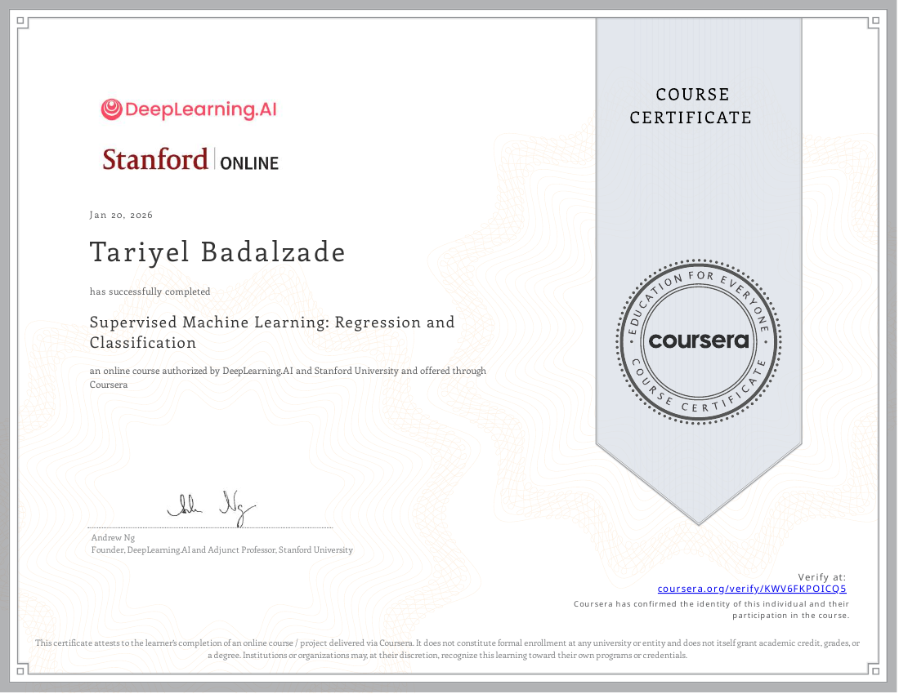
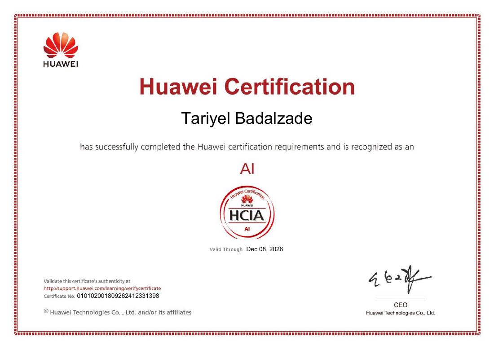

# AI and machine learning certificates

These certificate previews are rendered from the supplied certificate bundle. Only the two AI/ML credentials are included here.

## Supervised Machine Learning Regression and Classification

**Stanford University & DeepLearning.AI**, offered through Coursera. Awarded to **Tariyel Badalzade** on **January 20, 2026**.

[Coursera verification link printed on the certificate](https://www.coursera.org/verify/KWV6FKPOICQ5)

This is a course completion certificate for the named course.

## Huawei HCIA AI

**Huawei Certified ICT Associate — Artificial Intelligence**, awarded to **Tariyel Badalzade**. The certificate displays **December 8, 2026** as its “Valid Through” date, not its issue date. The supplied CV identifies the training as Artificial Intelligence V3.0.

The preview preserves the certificate number and issuer validation instructions. Live issuer validation has not been performed for this portfolio update.

[Back to portfolio](../README.md)
