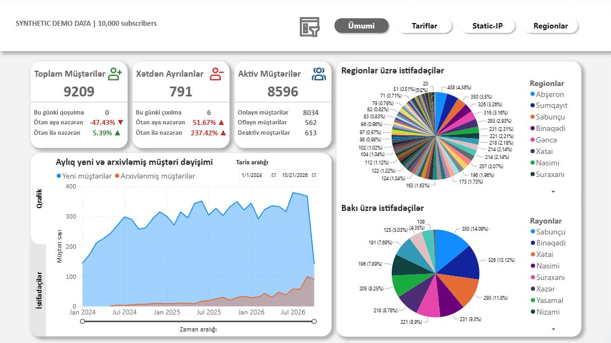
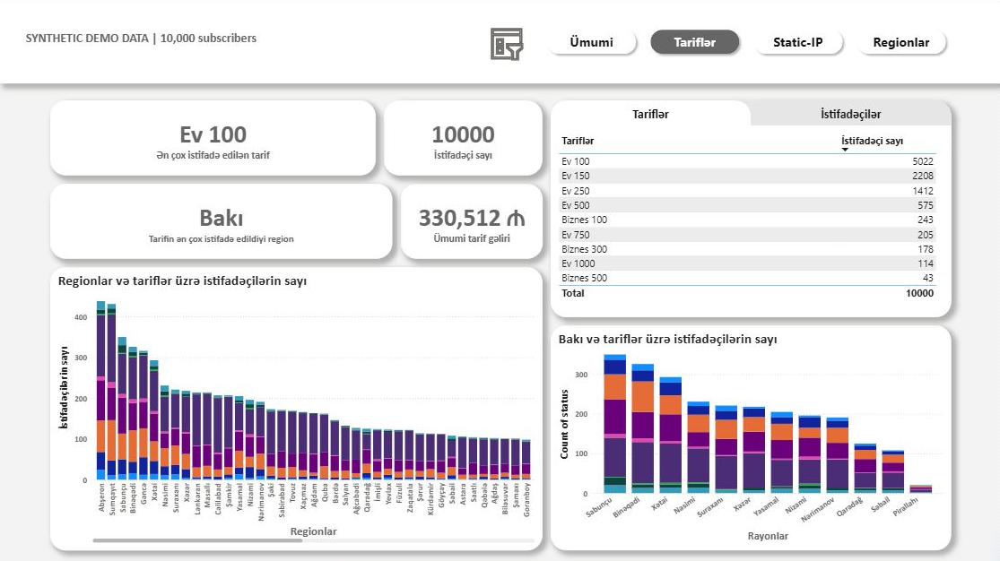
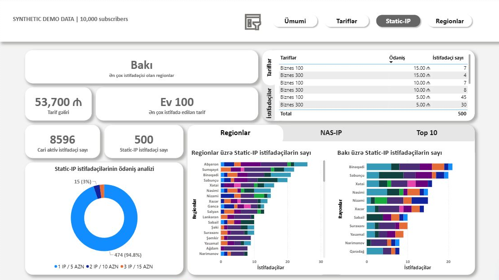
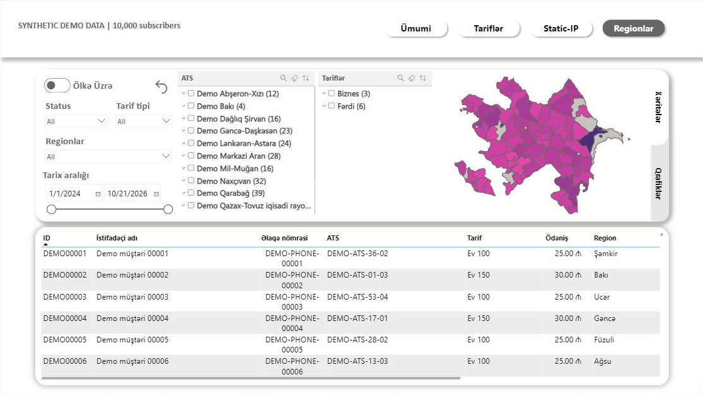

# Azerbaijan ISP Analytics Dashboard

**Power BI · DAX · Power Query · Synthetic data · Geographic analytics**

A four-page dashboard for exploring subscriber status, tariff mix, static-IP billing, and geographic distribution for a fictional internet service provider in Azerbaijan.

> **Synthetic data — portfolio demonstration.** All 10,000 subscriber records and 10,000 billing records are generated. The results describe a simulation, not a company's customers, revenue, coverage, or performance. No company database connection is required.

[Read the methodology](docs/DATA_METHODOLOGY.md)

## Business questions

- How do subscriber acquisition, archiving, and deactivation change over time?
- Which tariffs are most common across regions and Baku districts?
- How many distinct subscribers use static IP, and how do their invoices vary?
- How can operators explore subscriber segments through interactive filters and maps?

## Dashboard pages

| Page | What it demonstrates |
| --- | --- |
| **Ümumi — Overview** | Subscriber status, online/offline counts, acquisition and archiving trends, geographic mix |
| **Tariflər — Tariffs** | Plan adoption, summed recurring plan charges, regional and Baku comparisons |
| **Static-IP** | Distinct static-IP subscribers, invoice charges, plan and location breakdowns |
| **Regionlar — Regions** | Geographic maps, date/status/plan filters, and synthetic subscriber detail |

The report uses DAX measures, a calendar table, Power Query transformations, relationships, and bookmark-based navigation. The public version embeds generated data directly in its queries, so it opens without PostgreSQL, credentials, or local CSV paths.

### Tariff analysis

### Static-IP billing

### Regional analysis

## Model and data grain

| Table | Rows | Grain |
| --- | ---: | --- |
| `butun_musteriler` | 10,000 | One row per unique synthetic subscriber |
| `static_ip` | 10,000 | One monthly invoice for one static-IP subscriber |
| `Regions` | 75 | Public administrative-unit names |
| `Rayons` | 12 | Baku districts |
| `Calendar` | Generated | One row per date |

The billing table covers **500 distinct subscribers × 20 monthly periods**, March 2025–October 2026. Its `username` values link to subscriber `abonent_kodu` values. Subscriber and invoice dates support separate date relationships. Static-IP subscriber visuals use distinct counts, while billing charges sum invoice rows.

## Example results from the simulation

- **8,596 active**, **613 deactivated**, and **791 archived** subscribers reconcile to 10,000 records.
- **2,484 subscribers (24.84%)** are allocated to Baku and split across all 12 districts.
- **Ev 100** is the most common plan, with **5,022 subscribers (50.22%)**.
- **500 subscribers (5%)** have static-IP invoices; their 10,000 invoices sum to **53,700 AZN** in generated charges.

These are examples for demonstrating the dashboard, not findings about Azerbaijan's ISP market. The preserved overview card **Toplam Müştərilər** shows 9,209 non-archived subscribers; the tariff page includes all 10,000 subscriber records. The tariff charge card sums assigned monthly plan prices across those records and is not recognized revenue or cash collected. The static-IP charge total spans all 20 billing periods.

## Exploring the report

The four page previews above show the report without requiring Power BI Desktop. The interactive report uses date, region, status, and tariff filters; bookmark buttons switch between pages and views. In Desktop editing mode, navigation buttons use **Ctrl+click**.

The report was verified with Windows Power BI Desktop 2.159.883.0. Its data is embedded, with no PostgreSQL connection, credentials, or local CSV path required. No Power BI Service publication is needed.

## Geographic assumptions and limitations

Geographic weights combine official population at **1 January 2026** with **2025 household Internet-access rates** by economic region. Largest-remainder allocation gives exactly 10,000 subscribers. Baku's allocation is split by district population.

Population × household Internet access is an approximate distribution proxy, not an official fixed-broadband subscriber estimate. Internet access includes other connection types, population registration does not guarantee physical service availability, and the fictional operator is assumed to cover all listed units. The missing Eastern Zangazur access rate uses the national rate. Existing map geometry may lag administrative changes.

Public retail prices anchor the demo's price levels. Business packages, plan adoption, churn, connection status, account balances, usage, and static-IP adoption are explicit simulation assumptions. Current price references do not establish historical prices for the generated transactions. Relative-date measures can change when opened on a later date.

See [data methodology and public sources](docs/DATA_METHODOLOGY.md) for the full assumptions and source links.

## Verification

The saved PBIX was independently decoded to check both 10,000-row tables, unique subscriber IDs, invoice-to-subscriber links, 500 static-IP subscribers with 20 invoices each, 75 administrative units, and all 12 Baku districts. CSV identifiers were compared with the embedded tables. All four pages rendered in Desktop; the model has zero external data sources.

[Validation summary](docs/validation_summary.json) includes the PBIX checksum. All contact fields are clearly synthetic, IPs use documentation ranges, and no operational credentials are present.
