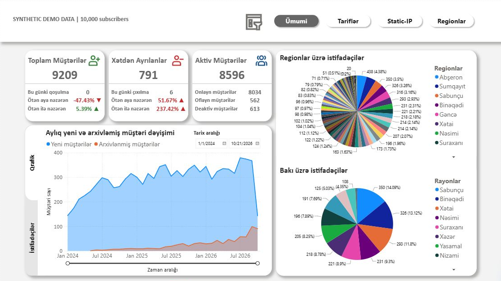
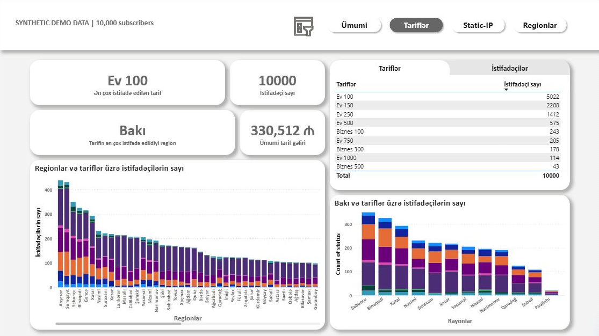
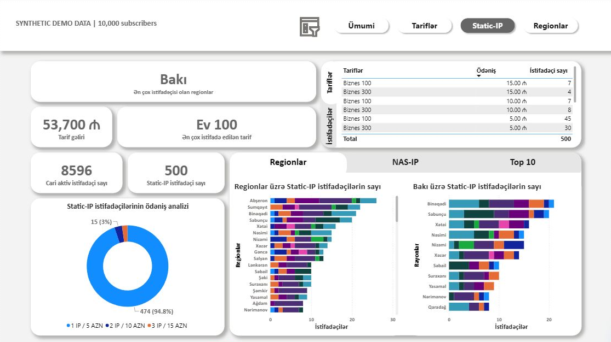
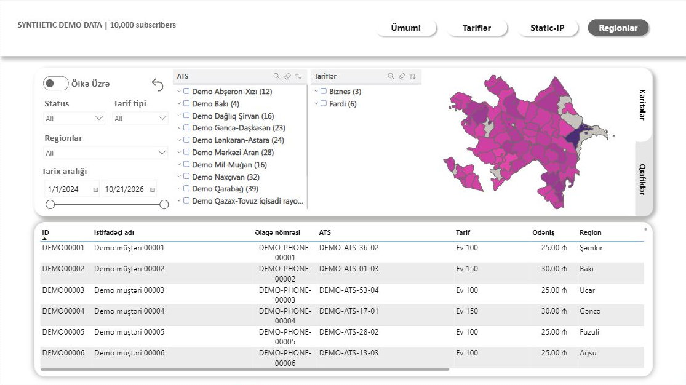

# Azerbaijan ISP Analytics Dashboard

**Power BI · DAX · Power Query · Data Modeling · Business Intelligence · Geographic Analytics**

A four-page, interactive Power BI portfolio project that turns synthetic telecommunications customer and billing records into an executive-friendly view of **subscriber status, product adoption, recurring-plan charges, static-IP billing, and regional distribution** in Azerbaijan.

> **Important:** This is a fictional ISP modeled with **synthetic customer-level data**, not a real operator's customer base. Figures below illustrate the behavior of the generated dataset; they are not market estimates, actual revenue, or employer results. The project does **not** currently demonstrate a real banking dataset, a validated retention-cohort analysis, a conversion funnel, or an A/B test.

## At a glance

| Component | Scope |
| --- | --- |
| Subscriber dataset | **10,000** unique synthetic subscriber accounts |
| Static-IP billing dataset | **10,000** invoice rows for **500** distinct accounts |
| Monthly billing periods | **20** (March 2025–October 2026) |
| Geographic coverage in simulation | **75** administrative units; Baku split into **12** districts |
| Report pages | **4** |
| Core technologies | Power BI Desktop, Power Query, DAX, calendar modeling, relationships, interactive slicers and bookmarks |
| Distribution | Self-contained PBIX with embedded synthetic data; no database credentials or external source required |

## Business problem

A service provider needs to answer routine commercial and operational questions without manually compiling separate spreadsheets:

- **Customer base:** How many accounts are active, archived, or deactivated? How do acquisition and status changes vary over time?
- **Products and tariffs:** Which plans have the highest adoption? How does the plan mix vary by geography?
- **Billing:** How many unique subscribers have static-IP service? What charges appear across invoice periods?
- **Geography:** Where are subscribers distributed, and which regions or Baku districts account for different portions of the customer base?
- **Self-service reporting:** Can stakeholders filter the same measures by date, customer status, tariff, or location without rebuilding the report?

The report organizes those questions into dedicated pages and a shared analytical model.

## Dashboard walkthrough

### 1. Ümumi — Subscriber overview

**Purpose:** provide a high-level picture of subscriber status and business activity.

The overview displays customer-state KPIs, online/offline views, acquisition and archiving trends, and geographic distribution. Date and other filters help investigate changes instead of relying only on totals.

**Metric-definition detail:** The preserved *Toplam Müştərilər* card shows **9,209 non-archived accounts**. The full synthetic subscriber dataset has **10,000 accounts**. The difference is intentional and reflects the card's filter definition, not lost records.

### 2. Tariflər — Tariff and product analytics

**Purpose:** understand product adoption and compare plans across customer locations.

The page explores subscription counts and assigned recurring-plan prices by tariff, region, and Baku district. For example, **Ev 100** is assigned to **5,022 of 10,000 accounts (50.22%)** in the simulation.

**Interpretation detail:** A sum of listed monthly plan charges is **not the same thing as revenue recognized or money collected**. The figures describe the assigned pricing mix in the model.

### 3. Static-IP — Subscriber and billing analytics

**Purpose:** connect an add-on service's subscriber population to its invoice activity.

The synthetic billing dataset contains **500 unique static-IP accounts**, each with **20 monthly invoice records**, resulting in **10,000 invoice rows**. The modeled charges total **53,700 AZN** over the full 20-month period.

This page demonstrates a critical modeling distinction:

- **Customer metric:** count *distinct* subscribers with static IP.
- **Transaction metric:** count or sum *invoice rows* for the selected period.

Counting invoice rows as subscribers would misleadingly report 10,000 static-IP customers rather than 500.

**Interpretation detail:** Invoice charges over 20 periods are not a single month's recurring revenue or verified payments received.

### 4. Regionlar — Geographic analytics

**Purpose:** compare location-level distributions with maps, filters, and subscriber detail.

In the synthetic allocation, **2,484 accounts (24.84%)** are placed in Baku, then distributed across **12 districts**. Additional administrative areas bring the modeled geography to **75 units**.

The geographic allocation is an approximation for dashboard demonstration, not a claim that one ISP covers those places or that those proportions represent the real broadband market.

## Data model

The project uses distinct analytical tables at deliberately different grains:

| Table | Rows / grain | Main role |
| --- | --- | --- |
| `customers` | 10,000 rows; one row per subscriber | Customer/account status, tariff, location, subscription attributes |
| `static_ip` | 10,000 rows; one monthly invoice per static-IP subscriber per period | Add-on billing records and charge analysis |
| `Regions` | 75 administrative units | Regional naming and mapping |
| `Rayons` | 12 Baku districts | District-level reporting |
| `Calendar` | Generated date dimension | Month and time-based analysis |

The subscriber table is keyed by `abonent_kodu`, and the billing table's `username` refers to the corresponding subscriber. Dates attached to customers and invoices have different analytical meanings, so the model supports separate date relationships.

### Why grain and relationships matter

Imagine one subscriber has invoices in 20 months. A join can return **20 rows**, even though there is only **one customer**. KPI definitions therefore need to specify *what is being counted*:

- Account population: count unique subscriber IDs under the desired status/filter definition.
- Static-IP adoption: distinct subscriber IDs present in the static-IP billing dataset.
- Invoices: count invoice records.
- Billing charges: sum relevant invoice amounts over the requested periods.

The published report uses DAX measures, Power Query transformations, table relationships, and a calendar table for these reporting needs. Exact metric behavior should be checked in the PBIX rather than inferred from a dashboard card's title alone.

## Analytical workflow and tools

**1. Data generation and assumptions.** Generate fictional subscribers and recurring invoices with documented business, geographic, pricing, and status assumptions. Public statistics are used only to guide geographic distribution, not to produce real customer records.

**2. Transformation and modeling.** Organize the data in Power Query, keep customer and invoice grains separate, and provide geography and dates for filtering.

**3. KPI calculations.** Build measures and views for statuses, plan adoption, distinct static-IP customers, invoice charges, and time comparisons. Use appropriate count-versus-distinct-count logic.

**4. Dashboard design.** Build four pages for different stakeholder questions, with slicers and bookmark-based navigation.

**5. Validation.** Compare the modeled totals and identifiers with saved source data and document what has and has not been verified.

This is principally a **Power BI / DAX / Power Query demonstration**. Although PostgreSQL and SQL are skills elsewhere in the broader portfolio, this public PBIX **does not require or establish a live SQL/PostgreSQL connection**.

## Example insights from the synthetic dataset

| Question | Example simulated observation | Responsible interpretation |
| --- | --- | --- |
| How many subscribers are active? | **8,596 active**, **613 deactivated**, **791 archived** | Status categories reconcile to 10,000 accounts; this is not a measured retention rate |
| Which tariff is most common? | **Ev 100: 5,022 accounts (50.22%)** | Simulated product mix, not observed market preference |
| How many accounts are allocated to Baku? | **2,484 (24.84%)** | Generated geographic allocation, not official provider coverage |
| How widely is static IP used? | **500 unique accounts (5%)** | Modeled adoption, distinct from 10,000 invoice rows |
| What is the static-IP invoice total? | **53,700 AZN** | Generated charges across 20 periods, not verified collections |

These examples are useful because each result has an **explicit denominator, grain, time span, or metric caveat**.

## How to explore the report

The repository includes a Power BI Desktop report, synthetic data, and dashboard previews. View the four images above for a quick tour, then open the PBIX in **Power BI Desktop** to interact with filters and navigation.

- Use date, tariff, status, and region controls to narrow the analysis.
- Use bookmark navigation to switch report views.
- In Desktop edit mode, some navigation buttons use **Ctrl+click**.
- No PostgreSQL server, passwords, local CSV paths, or Power BI Service publication are required for the self-contained public version.

The project was checked in **Power BI Desktop 2.159.883.0**. The saved report contains generated data embedded in its queries.

## Geographic data and simulation methodology

The synthetic geographic weights combine:

1. Administrative-unit **population at 1 January 2026**.
2. Economic-region **household internet-access rates for 2025**.
3. A **largest-remainder allocation** that produces exactly 10,000 subscribers.
4. A further population-based split of the Baku allocation across its 12 districts.

A missing rate for Eastern Zangazur is imputed using the **90.8% national rate**.

This is intentionally a **distribution proxy**. Household internet access is not identical to fixed-broadband subscription, population is not the same as a household count, administrative populations do not prove service coverage, and map boundaries can lag changes.

Tariff rates are anchored to public retail price examples, but the model's customer assignments, business package mix, churn/status behavior, usage, invoice activity, and static-IP adoption are **assumptions**. Current prices should not be mistaken for historical transaction rates.

See [the full data methodology, assumptions, and public sources](docs/DATA_METHODOLOGY.md).

## Validation and reproducibility

The repository documentation records checks of:

- The two embedded 10,000-row tables and subscriber identifiers.
- The **500 subscribers × 20 billing periods** structure.
- Invoice-to-subscriber links and distinct-count logic.
- The 75 administrative units and 12 Baku districts.
- The self-contained PBIX and all four report-page renders.
- The absence of external data-source dependencies and operational credentials.

[View the validation summary](docs/validation_summary.json).

The demo includes generated contact information and documentation-range IP addresses, not real personal customer data. Simulated metrics may vary under date filters, and relative-date measures can change if the report is opened later.

## Relevance to financial services and product analytics

Many of the **transferable analytical methods** also matter in banking:

| ISP analytics skill demonstrated here | Comparable banking analysis |
| --- | --- |
| Unique customer counts and status categories | Active customers, inactive accounts, customer base reconciliation |
| Tariff mix by region | Card, loan, or product adoption by segment |
| Monthly invoice counts and charges | Transaction counts, balances, and fee reporting |
| Interactive KPI reporting | Product and business performance monitoring |
| Geography-based customer segmentation | Location-level customer or product analysis |

**Scope boundary:** This project shows descriptive customer and business intelligence, not a completed banking dataset, retention-cohort study, behavioral funnel, or controlled A/B experiment. Those would require additional event or activity data and separate analysis.

### Potential future extensions (not yet implemented)

- **Retention cohorts:** track activity/eligibility by signup month and subsequent months.
- **Conversion funnel:** model onboarding events such as signup, verification, activation, and first service use.
- **A/B evaluation:** add explicitly simulated control/treatment assignments, success metrics, confidence intervals, and experiment caveats.
- **Banking analytics adaptation:** use a separate synthetic banking schema to analyze account activity, payments, and digital product adoption.

## Further links

- [Data methodology and source references](docs/DATA_METHODOLOGY.md)
- [Validation summary](docs/validation_summary.json)
- [Back to profile overview](../../README.md)

---

*Portfolio demonstration built for analytical reproducibility and clear KPI interpretation. All customer and billing values are fictional.*
