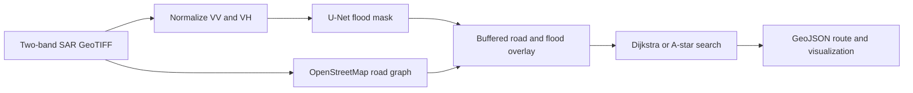

# Flood Detection and Route Planning from Satellite Imagery

**Sentinel-1 SAR · PyTorch U-Net · OpenStreetMap · Dijkstra / A\***

A bachelor's dissertation project connecting satellite image segmentation with a road-network routing prototype. A two-channel U-Net predicts flood masks from Sentinel-1 imagery; a geospatial pipeline overlays those masks on roads and searches for routes that avoid predicted flooding where possible.

[Evaluation evidence](reports/evaluation_results.json) · [Dataset and splits](data/README.md) · [Method and limitations](reports/METHODS.md) · [Back to portfolio](../../README.md)

## Results


| Metric | Saved test result |
| :--- | ---: |
| Flood-class IoU | 0.6766 |
| F1 / Dice | 0.8071 |
| Precision | 0.7770 |
| Recall | 0.8396 |
| Pixel accuracy | 0.9526 |

Results cover **66 test chips** and pool confusion counts across valid pixels. They are copied from the original saved evaluation, with aggregates checked against per-chip counts; inference was not rerun for this publication. Flood-class IoU is not mean IoU across classes. The validation and test manifests both include Spain, so this is not a fully event-independent validation/test benchmark. See [evaluation details](reports/METHODS.md).

## How it works



- **Segmentation:** U-Net encoder/decoder with skip connections; weighted focal plus Dice loss, augmentation, and flood-weighted sampling.
- **Geospatial processing:** georeferenced masks, projected road buffering, and raster overlap to estimate flood exposure per road edge.
- **Routing:** nearest-node matching, optional endpoint substitution, weighted path search, and route status reporting.
- **Outputs:** flood mask GeoTIFF, route GeoJSON when available, a visualization, and a run summary.

This is a research prototype. Predicted masks and generated routes have not been validated for emergency navigation. Flooded edges receive a large finite cost, so a returned route can still cross predicted flooding; read its status. Roads outside the image and missing SAR pixels can be treated as dry by the current implementation.

## Included files

| File | Purpose |
| :--- | :--- |
| `models/unet.py` | Two-channel binary segmentation model |
| `dataset.py`, `train.py` | Data loading, augmentation, training, checkpointing |
| `predict.py`, `evaluate.py` | Inference and valid-pixel evaluation |
| `road_extraction.py`, `overlay.py`, `routing.py` | Road graph, flood overlap, route search |
| `pipeline.py`, `visualize.py` | End-to-end orchestration and map export |
| `split_into_chips.py` | Split larger rasters into chips |
| `config.yaml`, `requirements.txt` | Configuration and dependency versions |
| `data/splits/` | Original split memberships with portable paths |
| `reports/` | Saved per-chip results, chart, and methodology |

Large rasters, model weights, local environments, duplicate archives, and dissertation documents are excluded. **No pretrained checkpoint is distributed:** train one before running inference, or use your own trusted compatible checkpoint. There is no hosted demo.

## Setup

Run commands from this project directory. Python **3.10 or 3.11** is suggested for the original pinned dependencies. A clean installation and full pipeline run have not yet been verified; the original local virtual environment points to a missing Python installation.

```bash
git clone https://github.com/TariyelBadalzade/TariyelBadalzade.git
cd TariyelBadalzade/projects/flood-detection
python -m venv .venv
```

Activate with `.venv\Scripts\Activate.ps1` in PowerShell or `source .venv/bin/activate` on Linux/macOS. Then install the CPU build for a first run:

```bash
python -m pip install --upgrade pip
python -m pip install torch==2.2.0 torchvision==0.17.0 --index-url https://download.pytorch.org/whl/cpu
python -m pip install -r requirements.txt
```

For GPU training, install a compatible CUDA PyTorch build instead. Prepare the input rasters using [the data guide](data/README.md); the included manifests expect two-band VV/VH images already in dB and aligned labels.

```bash
python train.py --config config.yaml
python evaluate.py --config config.yaml
python predict.py --input data/sen1floods11/S1Hand/Spain_2938657_S1Hand.tif --checkpoint models/checkpoints/best_model.pth --output outputs/flood_mask.tif
```

For a route, choose origin and destination coordinates inside your input chip and substitute actual decimal latitude/longitude values:

```bash
python pipeline.py --config config.yaml --input data/your_chip.tif --origin "LATITUDE,LONGITUDE" --dest "LATITUDE,LONGITUDE"
```

The route pipeline queries OpenStreetMap over the internet. Insufficient road coverage can stop the run. `config.yaml` sets a segmentation threshold of 0.5 and a road flood threshold of 0.10; the saved evaluation does not itself record the run configuration or checkpoint hash.

## Next improvements

- Rebuild a clean environment and record a complete run with checkpoint and dataset hashes.
- Use event-disjoint validation and test sets, then compare against a simple baseline.
- Add ground-truth/prediction examples, failure cases, and an independent routing evaluation.
- Treat unobserved road coverage explicitly; avoid inferring route safety from missing data.

## Attribution and reuse

Dataset: [Sen1Floods11](https://github.com/cloudtostreet/Sen1Floods11), Bonafilia et al. (2020). Road data: [OpenStreetMap contributors](https://www.openstreetmap.org/copyright). Follow the upstream dataset terms and OSM attribution requirements. No additional code license is granted by this publication.
