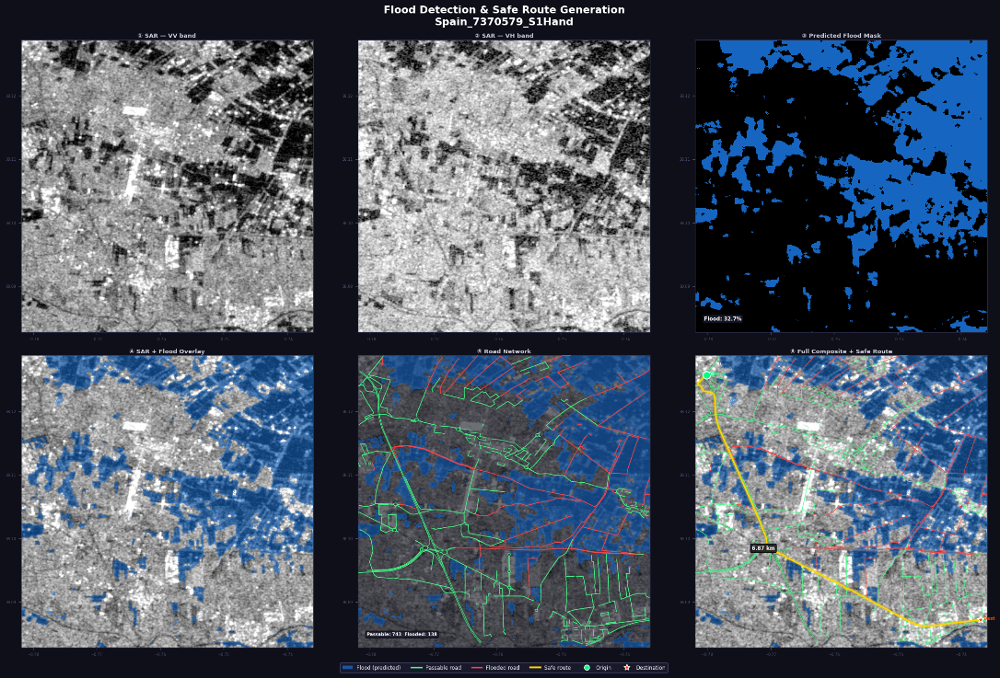
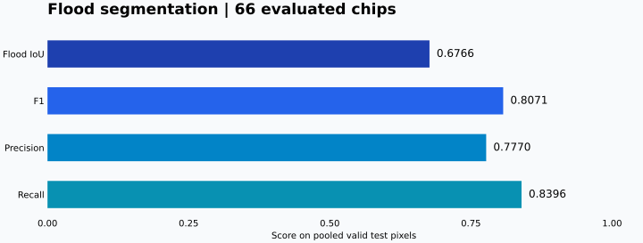
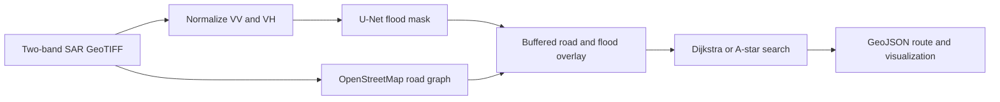
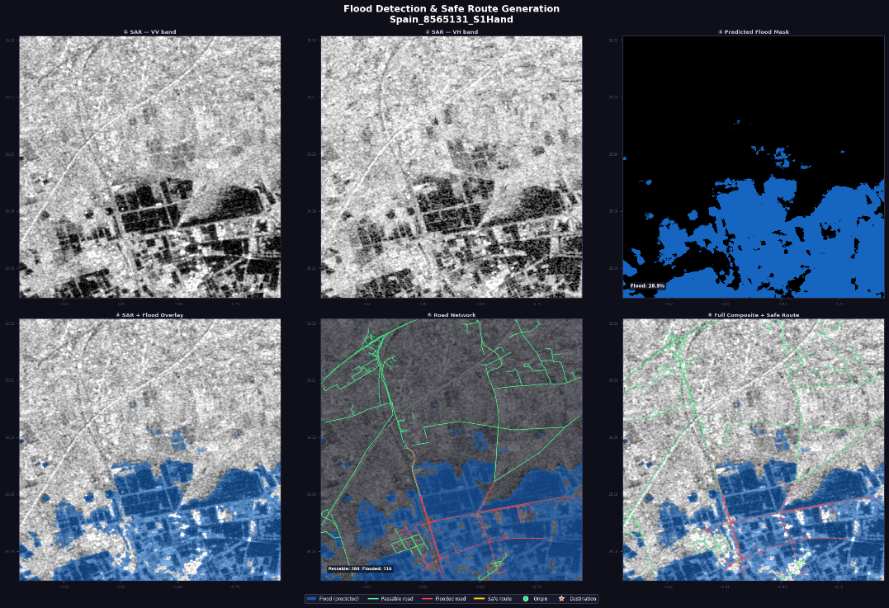
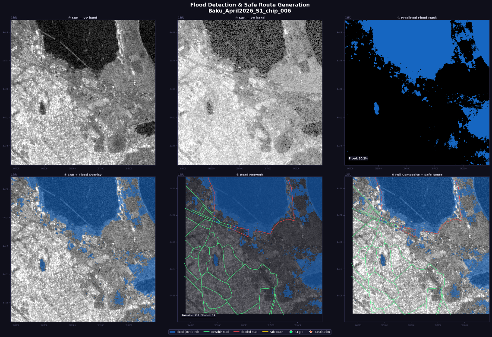

# Flood Detection and Route Planning from Satellite Imagery

**Sentinel-1 SAR · PyTorch U-Net · OpenStreetMap · Dijkstra / A\***

A bachelor's dissertation project connecting satellite image segmentation with a road-network routing prototype. A two-channel U-Net predicts flood masks from Sentinel-1 imagery; a geospatial pipeline overlays those masks on roads and searches for routes that avoid predicted flooding where possible.

[Evaluation evidence](reports/evaluation_results.json) · [Dataset and splits](data/README.md) · [Method and limitations](reports/METHODS.md) · [Back to portfolio](../../README.md)

## The problem and my contribution

Flood mapping becomes more useful when its output can be related to roads and access. This dissertation explores that connection: identify likely water/flood pixels in radar imagery, estimate which road segments overlap the prediction, then search the resulting road graph between two locations.

I implemented the segmentation and geospatial routing pipeline in Python, including data loading and augmentation, U-Net training and inference, valid-pixel evaluation, road/raster alignment, flood exposure scoring, and map exports. Sentinel-1 supplies two radar polarization channels, **VV and VH**; using radar makes the approach relevant when cloud cover limits optical imagery.

The engineering challenge extends beyond training a model. Raster pixels and road geometries must line up spatially, road widths must be buffered in a metric coordinate system, and segmentation errors must remain visible when interpreting a route.

## From satellite imagery to a route



**Spain — `Spain_7370579_S1Hand`.** Read left to right across the top row for the VV radar channel, VH radar channel, and predicted mask. The bottom row adds the mask to the image, classifies road exposure, and displays a generated route. Blue indicates predicted water/flood pixels, green/red show model-based road classifications, and yellow marks the route. The saved figure labels the route **6.87 km**; this is an example output, not a routing accuracy or safety measurement.

The figures are original outputs retained in the dissertation. Their embedded labels say “safe route” and “passable”; in this portfolio those labels refer to the prototype's predictions, not independently verified road conditions. Click an image to inspect its full resolution.

## Results



| Metric | Saved test result |
| :--- | ---: |
| Flood-class IoU | 0.6766 |
| F1 / Dice | 0.8071 |
| Precision | 0.7770 |
| Recall | 0.8396 |
| Pixel accuracy | 0.9526 |

Results cover **66 test chips** and pool confusion counts across valid pixels. They are copied from the original saved evaluation, with aggregates checked against per-chip counts; inference was not rerun for this publication. Flood-class IoU is not mean IoU across classes. The validation and test manifests both include Spain, so this is not a fully event-independent validation/test benchmark. See [evaluation details](reports/METHODS.md).

## How it works



- **Segmentation:** U-Net encoder/decoder with skip connections; weighted focal plus Dice loss, augmentation, and flood-weighted sampling.
- **Geospatial processing:** georeferenced masks, projected road buffering, and raster overlap to estimate flood exposure per road edge.
- **Routing:** nearest-node matching, optional endpoint substitution, weighted path search, and route status reporting.
- **Outputs:** flood mask GeoTIFF, route GeoJSON when available, a visualization, and a run summary.

This is a research prototype. Predicted masks and generated routes have not been validated for emergency navigation. Flooded edges receive a large finite cost, so a returned route can still cross predicted flooding; read its status. Roads outside the image and missing SAR pixels can be treated as dry by the current implementation.

## Flood detection in more detail

The model treats the task as **binary semantic segmentation**: each valid pixel receives a water/flood probability. An encoder learns spatial context from VV and VH, while a decoder and skip connections recover a mask at the input resolution. The published configuration uses a base width of 32, dropout of 0.3, and a probability threshold of 0.5.

The data loader uses training-set mean/std statistics, flips and rotations, and Gaussian noise augmentation. Flood-weighted sampling and the weighted focal + Dice objective address the imbalance between flood and background pixels. Training uses AdamW, a cosine learning-rate schedule, early stopping, and mixed precision when CUDA is available. These describe the retained implementation; the historical evaluation file does not identify its exact checkpoint or run settings.

The split manifests contain **373 training, 6 validation, and 66 test chips**. IoU measures overlap between predicted and labelled flood pixels; precision measures how many predicted flood pixels are correct, while recall measures how many labelled flood pixels are recovered. The saved recall of **0.8396** and precision of **0.7770** show why both missed water and false alarms matter when the mask is carried into road analysis.

## Connecting predictions to roads

OSM roads are retrieved for the image area and projected to UTM so road-width buffers can be expressed in metres. Buffered geometries are transformed back into the raster coordinate system, then rasterized onto the mask grid. The fraction of predicted flood pixels inside each footprint becomes that road edge's flood exposure.



**Spain — `Spain_8565131_S1Hand`.** This example makes the overlay step easy to see: the predicted water region occupies much of the lower image, with road segments coloured red where the configured exposure threshold is exceeded. The figure reports **28.9% predicted coverage**, **284 passable-labelled edges**, and **116 flooded-labelled edges**. Those are saved visualization annotations, not ground-truth measurements. This figure does not display a completed yellow route.

Dijkstra or A* then searches using length-based costs on unflagged roads and large penalties on flagged roads. Endpoint matching and optional substitution connect requested coordinates to the graph. The published configuration uses a **0.10 road flood threshold**; the separate local batch visualization script uses **0.30**, so these historical figures should not be read as outputs of one fully recorded configuration.

## Applying the model around Baku



**Baku — `Baku_April2026_S1_chip_006`.** The dissertation includes an application example using April 2026 imagery around Baku. The figure shows the same chain from VV/VH inputs to a predicted mask and road overlay, making the work relevant to a local setting beyond the saved Spain/Sri Lanka test evaluation.

This is a **qualitative application example**: no independent labels or Baku accuracy scores accompany the figure. A single-image water prediction can include permanent water as well as inundation; blue pixels alone do not establish newly flooded land. The screenshot shows road classifications but no completed yellow route. Dissertation application examples also cover Valencia and Dubai; they are not additional quantitative benchmark results.

## What the examples reveal

The useful result is a connected workflow: a model prediction becomes a georeferenced raster, then a road exposure attribute, then an input to a graph search. The figures also expose where interpretation is difficult. Urban surfaces and radar shadows can resemble water, permanent water needs to be distinguished from new inundation, and incomplete image or road coverage can affect routing.

A high pixel accuracy does not by itself establish reliable flood detection or usable routes. The saved test metrics, qualitative images, and routing outputs answer different questions; the [methods document](reports/METHODS.md) records their limits.

## Included files

| File | Purpose |
| :--- | :--- |
| `models/unet.py` | Two-channel binary segmentation model |
| `dataset.py`, `train.py` | Data loading, augmentation, training, checkpointing |
| `predict.py`, `evaluate.py` | Inference and valid-pixel evaluation |
| `road_extraction.py`, `overlay.py`, `routing.py` | Road graph, flood overlap, route search |
| `pipeline.py`, `visualize.py` | End-to-end orchestration and map export |
| `split_into_chips.py` | Split larger rasters into chips |
| `config.yaml`, `requirements.txt` | Configuration and dependency versions |
| `data/splits/` | Original split memberships with portable paths |
| `reports/` | Saved per-chip results, chart, and methodology |

Large rasters, model weights, local environments, duplicate archives, and dissertation documents are excluded. **No pretrained checkpoint is distributed:** train one before running inference, or use your own trusted compatible checkpoint. There is no hosted demo.

## Setup

Run commands from this project directory. Python **3.10 or 3.11** is suggested for the original pinned dependencies. A clean installation and full pipeline run have not yet been verified; the original local virtual environment points to a missing Python installation.

```bash
git clone https://github.com/TariyelBadalzade/TariyelBadalzade.git
cd TariyelBadalzade/projects/flood-detection
python -m venv .venv
```

Activate with `.venv\Scripts\Activate.ps1` in PowerShell or `source .venv/bin/activate` on Linux/macOS. Then install the CPU build for a first run:

```bash
python -m pip install --upgrade pip
python -m pip install torch==2.2.0 torchvision==0.17.0 --index-url https://download.pytorch.org/whl/cpu
python -m pip install -r requirements.txt
```

For GPU training, install a compatible CUDA PyTorch build instead. Prepare the input rasters using [the data guide](data/README.md); the included manifests expect two-band VV/VH images already in dB and aligned labels.

```bash
python train.py --config config.yaml
python evaluate.py --config config.yaml
python predict.py --input data/sen1floods11/S1Hand/Spain_2938657_S1Hand.tif --checkpoint models/checkpoints/best_model.pth --output outputs/flood_mask.tif
```

For a route, choose origin and destination coordinates inside your input chip and substitute actual decimal latitude/longitude values:

```bash
python pipeline.py --config config.yaml --input data/your_chip.tif --origin "LATITUDE,LONGITUDE" --dest "LATITUDE,LONGITUDE"
```

The route pipeline queries OpenStreetMap over the internet. Insufficient road coverage can stop the run. `config.yaml` sets a segmentation threshold of 0.5 and a road flood threshold of 0.10; the saved evaluation does not itself record the run configuration or checkpoint hash.

## Next improvements

- Rebuild a clean environment and record a complete run with checkpoint and dataset hashes.
- Use event-disjoint validation and test sets, then compare against a simple baseline.
- Add paired ground-truth/prediction comparisons and quantified failure cases alongside the historical application images.
- Evaluate routing independently with verified road conditions and origin/destination pairs.
- Treat unobserved road coverage explicitly; avoid inferring route safety from missing data.

## Attribution and reuse

Dataset: [Sen1Floods11](https://github.com/cloudtostreet/Sen1Floods11), Bonafilia et al. (2020). Road data: [OpenStreetMap contributors](https://www.openstreetmap.org/copyright). Selected project figures show Sentinel-1 imagery and OpenStreetMap-derived road overlays; see [image provenance](images/README.md). Follow the upstream dataset terms and OSM attribution requirements. No additional code license is granted by this publication.
