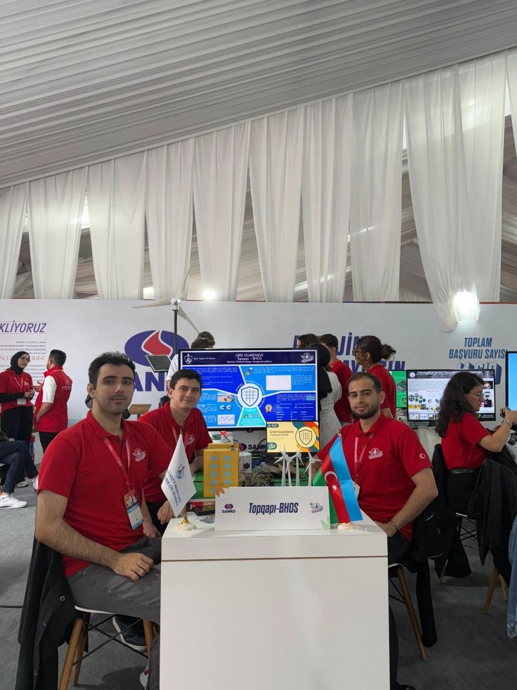

# Grid Energy — IoT and ML for Energy Management

**Energy-demand forecasting · Machine learning · Time series · IoT · Renewable energy**

A Baku Higher Oil School team project exploring how sensor data and energy-demand forecasts can support more efficient use of renewable power in urban and industrial buildings.

**My contribution:** machine learning and modeling for the project's energy-forecasting component.

  

*The team presenting the energy-management demonstration. Photo supplied from the project.*

## Problem

Solar and wind generation vary with environmental conditions, while building demand changes over time. The project investigates combining IoT monitoring with forecasting to help align consumption with available renewable supply and inform energy-use decisions.

## ML and forecasting approach

The project report describes a forecasting workflow using energy-consumption measurements and environmental variables such as temperature, humidity, and wind speed:

1. Handle missing measurements and normalize inputs.
2. Explore temporal and environmental patterns in consumption.
3. Use **ARIMA and SARIMA** to model time-series structure, and **LSTM and Random Forest** approaches for multivariate relationships.
4. Evaluate forecasting error with **MAE and RMSE**.
5. Use forecasts to inform energy-use feedback, with model adaptation as a direction for changing consumption patterns.

These are the methods described in the team report. Individual model artifacts, training code, and measured MAE/RMSE results are not included in this case study, so it does not rank the models or claim a validated forecasting result.

## Documented system architecture

The broader team design connects **ESP32** devices and voltage/current, light, and temperature sensors to cloud monitoring through **MQTT**. The report discusses **AWS IoT Core**, **DynamoDB**, and **Lambda** for ingestion, storage, and processing, with smart plugs and monitoring devices supporting energy-use feedback and control.

This summarizes the architecture described in the report; the photo documents a team demonstration rather than a production deployment. My role was in ML and modeling within this wider team effort.

## Project evidence

- [Team project report: IoT and Green Energy Based Energy Efficiency Optimization System for City or Industrial Buildings](https://docs.google.com/document/d/1AawAjRrsdxC8OjsFxXWYpA9XZ_aZsFeif5SldjFfsBs/edit?tab=t.0)
- Team demonstration photograph above.

The report lists Tariyel Badalzade among its authors. It discusses expected benefits and example calculations but does not provide a reproducible model benchmark or a controlled before/after energy study. This portfolio entry therefore makes no measured energy-saving, carbon-reduction, or production-performance claims.
