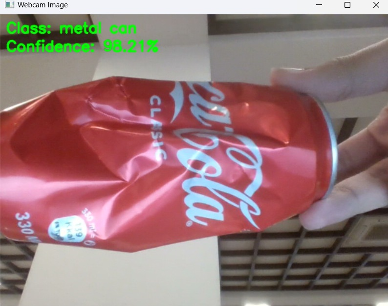
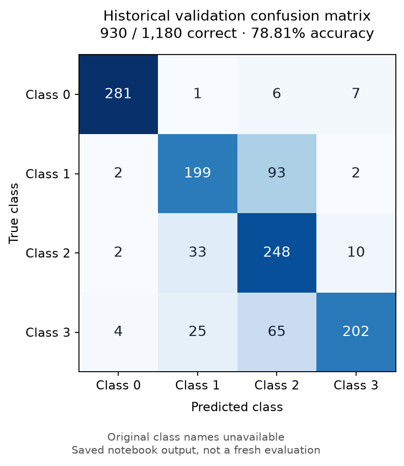

# Water Trash Classification

**Computer vision · TensorFlow / Keras · OpenCV · CNN · Webcam inference · Voice alerts**

A team course project exploring waste recognition as a vision component for a proposed water-trash collector. The retained materials include a four-class CNN experiment and a separate webcam classification prototype with spoken alerts.

The project report names **Rovshan Yusifov and Tariyel Badalzade**. This entry presents the retained team materials; it does not assign sole authorship of each component.

*Saved webcam demonstration. The displayed 98.21% is one prediction's model confidence, not measured classification accuracy.*

## What the prototype does

- Processes webcam frames at 224 × 224 pixels with Keras and OpenCV.
- Displays a class label and model confidence for the whole frame.
- Starts and pauses predictions with **S / Q**, and exits with **Esc**.
- Uses `pyttsx3` for spoken alerts above an 85% confidence threshold, with a three-second cooldown and prediction pause.

The rectangle in the webcam script surrounds the entire frame. This is **image classification**, not an object detector that predicts object locations. The robot and collection hardware are the intended application; a working autonomous collector is not verified by the supplied code and screenshot.

## CNN experiment and saved evaluation

The [cleaned notebook](notebooks/cnn_experiment.ipynb) preserves the separate four-class CNN architecture: convolution/pooling blocks, batch normalization, L2 regularization, dense layers, and dropout. Training uses augmented images and Adam optimization; the original callbacks monitored training loss.

| Evidence from saved notebook output | Value |
| --- | ---: |
| Training images reported | 1,318 |
| Validation images in saved confusion matrix | 1,180 |
| Correct validation predictions | 930 |
| Accuracy calculated from that matrix | **78.81%** |

[Inspect the evaluation counts and limitations](reports/evaluation.json)

These are historical validation outputs, not a new run or independent test result. The reported training/validation counts do not match the original intended 80/20 split; saved cells may come from different runs. Original data, split memberships and class-index names are unavailable. The matrix retains numeric class indices rather than inventing a label order. The report's 85% accuracy claim is not used here.

## Two separate model paths

| Artifact | Scope |
| --- | --- |
| `notebooks/cnn_experiment.ipynb` | Four-class CNN training experiment with `[0, 1]` input rescaling |
| `examples/webcam_voice_alerts.py` | Historical Keras H5 webcam prototype using `[-1, 1]` input scaling and an external `labels.txt` |

The available materials do not establish that the webcam model is the trained CNN from the notebook. Its missing label file prevents verifying the output-to-class mapping, so model weights are not bundled and the notebook evaluation is not attributed to the webcam demo.

## Setup and reproduction scope

Use a Python environment compatible with your TensorFlow/Keras model export, then install the dependencies in `requirements.txt`. Dependency versions were not recorded in the original project.

For the CNN notebook, prepare separate `train/<class>/` and `val/<class>/` directories and set `WASTE_DATA_ROOT` to their parent folder. Launch Jupyter and run the notebook. It requires your own dataset; the historical result cannot be reproduced from the retained artifacts alone.

For the historical webcam example, provide its matching `keras_model.h5` and verified `labels.txt` in the working directory before running `python examples/webcam_voice_alerts.py`. The camera and local text-to-speech engine are required. The preserved script's recycling-status rules are simplified demo labels, not general recycling guidance. Its camera-frame color order should also be checked against the model export before reuse.

This portfolio preparation checked Python syntax and recalculated the saved matrix. Training, model loading, webcam inference, and voice playback were not rerun. The screenshot records a previous demonstration.

## Provenance and preparation

- Source material: the retained course report, `modelling.ipynb`, `new_detection.py`, and the saved webcam screenshot.
- The notebook was made portable by replacing machine-specific paths, clearing outputs, and removing the legacy dataset-copy cells. Its inconsistent four-output/five-class ROC example was omitted; no AUC result is claimed.
- Teachable Machine-style webcam export code is a starting point for the prototype. This entry does not claim the export boilerplate as an original algorithm.
- A downloaded [Garbage Classification System by supriya811106](https://github.com/supriya811106/Garbage-Classification-System) was also present in the source folder. That third-party VGG16 project, its weights, and its results are not included or claimed as this team's work.
- Other students' assignment lists, presentation-template assets, full reports, and unrelated coursework are excluded.
